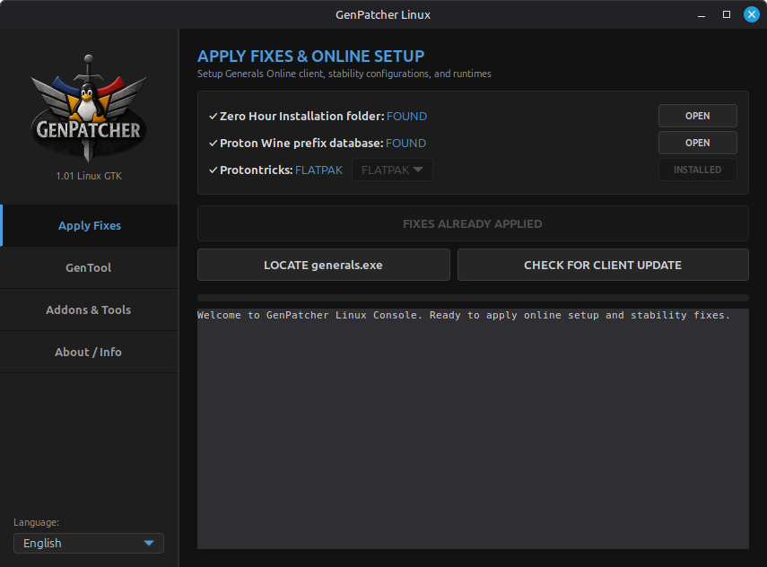
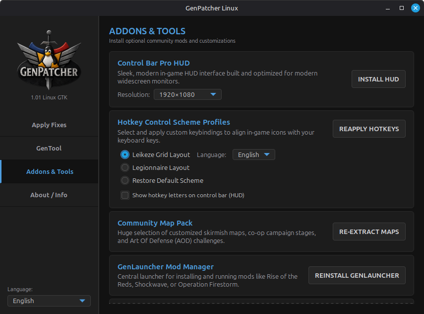

# GenPatcher Linux

<p align="center">
  
</p>

An open-source utility designed to configure, patch, and optimize Command & Conquer: Generals and Zero Hour for Wine and Proton environments. It automates prefix setup, registry DLL overrides, resolution matching, and mod deployment natively on Linux distributions.


---

## Technical Dependencies

Ensure all required dependencies are installed on your system before launching the utility.

### 1. Python 3 and GTK 3 Bindings
The graphical user interface is built on PyGObject (GTK 3). Install the necessary components using your distribution's package manager:

* **Arch Linux / Manjaro / CachyOS**:
  ```bash
  sudo pacman -S python python-gobject gtk3
  ```
* **Ubuntu / Debian / Linux Mint**:
  ```bash
  sudo apt update
  ```
  ```bash
  sudo apt install python3 python3-gi python3-gi-cairo gir1.2-gtk-3.0
  ```
* **Fedora**:
  ```bash
  sudo dnf install python3 python3-gobject gtk3
  ```

### 2. Proton / Wine Compatibility Helpers
* **Protontricks**: Required to configure DLL overrides within the Proton prefix (directing the environment to load native community Direct3D wrapper DLLs). GenPatcher auto-detects Flatpak or a native `protontricks` binary (Flatpak is preferred when both are installed). Install it using one of the following commands:

  * **Arch Linux / Manjaro / CachyOS**:
    ```bash
    sudo pacman -S protontricks
    ```
  * **Ubuntu / Debian / Linux Mint**:
    ```bash
    sudo apt install protontricks
    ```
  * **Fedora**:
    ```bash
    sudo dnf install protontricks
    ```
  * **Flatpak (Universal)**:
    ```bash
    flatpak install flathub com.github.Matoking.protontricks
    ```
---


## Usage


### Download AppImage

Download the latest AppImage from the [releases page](https://github.com/Fennek88/GenPatcher-Linux/releases).
Browsers download it without the executable permission, so make it executable first:
right-click the file → Properties → Permissions → "Allow executing as program", or run:

```bash
chmod +x GenPatcher-Linux-x86_64.AppImage
```

Then double-click the AppImage to run it.


### Clone repository and run Python app

To clone and run the application:

```bash
git clone https://github.com/Fennek88/GenPatcher-Linux
cd GenPatcher-Linux
python3 GenPatcher.py
```

---


## Updates

From version 1.0.3 the application has a built in self-update-function that checks for new releases and updates itself automatically or on request.

---


## Screenshots




